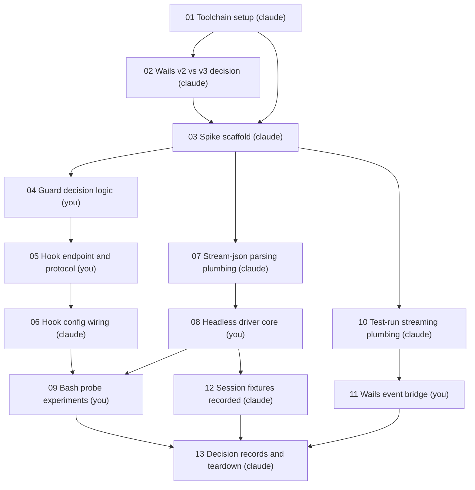

# M0: Spike

> [!info] Next up
> After Claude's scaffolding: [[uwu/m0-spike/04.03-guard-decision-logic|04 Guard decision logic]], step 1. Owner: you.

## Tasks

| # | Task | Owner | Depends on | Status | Walkthrough | Notes |
|---|------|-------|------------|--------|-------------|-------|
| 01 | Toolchain setup | claude | none | not-started | n/a | Install Wails CLI; Go and pnpm already present. Ask before system-wide installs. |
| 02 | Wails v2 vs v3 decision | claude | 01 | not-started | n/a | Rule: v2 unless v3 has a stable release. Decision record in docs/decisions/. |
| 03 | Spike scaffold | claude | 01, 02 | not-started | n/a | wails init in spike/, go module, fake target repo with guarded paths. All throwaway. |
| 04 | Guard decision logic | you | 03 | not-started | [[uwu/m0-spike/04.03-guard-decision-logic\|04 Guard decision logic]] | Pure Go: tool call + guarded set in, allow/deny with reason out. Table tests define done. |
| 05 | Hook endpoint and protocol | you | 04 | not-started | [[uwu/m0-spike/05.04-hook-endpoint-and-protocol\|05 Hook endpoint and protocol]] | Local socket server, PreToolUse payload, deny-response shape. Protocol design survives to M1. |
| 06 | Hook config wiring | claude | 05 | not-started | n/a | Claude Code hook settings for the spawned session, pointing at the endpoint. |
| 07 | Stream-json parsing plumbing | claude | 03 | not-started | n/a | Parse claude -p stream-json output into Go events. Mechanical. |
| 08 | Headless driver core | you | 07 | not-started | [[uwu/m0-spike/08.07-headless-driver-core\|08 Headless driver core]] | Spawn claude -p, session lifecycle, gated phases. Fake-claude test defines done. |
| 09 | Bash probe experiments | you | 06, 08 | not-started | [[uwu/m0-spike/09.06.08-bash-probe-experiments\|09 Bash probe experiments]] | Try writing guarded files via echo/sed/scripts; document what the hook saw. Feeds M4 enforcement design. |
| 10 | Test-run streaming plumbing | claude | 03 | not-started | n/a | Exec go test in the fake target repo, capture output as a stream. Mechanical. |
| 11 | Wails event bridge | you | 10 | not-started | [[uwu/m0-spike/11.10-wails-event-bridge\|11 Wails event bridge]] | Emit the test-run stream as Wails runtime events, catch in a throwaway React page. Walkthrough must include a teaching TODO(you) that explains the Wails-React bridge itself. |
| 12 | Session fixtures recorded | claude | 08 | not-started | n/a | Record real claude headless sessions to files in docs/fixtures/. Survives teardown; models M1 fake driver. |
| 13 | Decision records and teardown | claude | 09, 11, 12 | not-started | n/a | Draft all decision records for user ratification, then delete spike/. Only docs/decisions/ and docs/fixtures/ survive. |

### Dependency tree

## Problem Statement

uwu's entire architecture (PLAN.md) rests on three unverified bets: that a PreToolUse hook can actually enforce path ownership on a headless Claude Code subprocess, that `claude -p` with stream-json output can be driven from Go through gated phases, and that Wails (v2 or v3) can carry the Go-to-React live-update contract. If any of these is wrong, everything from M1 onward is built on sand. I need to know before I invest in the real build.

## Solution

A throwaway spike that proves or disproves each bet. The spike code lives in an isolated directory and is deleted at the end; what survives is a set of decision records (hook enforcement verdict, CLI vs SDK, Wails version, Bash-hole findings) and recorded real Claude session fixtures that M1's fake driver will be modeled on. I implement every discovery-dense piece myself (guard logic, hook endpoint, driver core, Bash probes, Wails event bridge) so the knowledge M0 exists to produce lands in my head, not just in the records.

## User Stories

1. As the uwu builder, I want to know whether a PreToolUse hook deterministically blocks Edit/Write calls on guarded paths with a readable denial, so that I can commit to CLI-subprocess enforcement or fall back to the Go SDK.
2. As the uwu builder, I want to drive a headless Claude session from Go through gated phases (work, pause for approval, resume), so that I know the M3/M4 engine design is feasible.
3. As the uwu builder, I want the Wails v2 vs v3 decision made from current release status, so that M2's shell choice is settled.
4. As the uwu builder, I want to see a real test run streamed from Go into a Wails runtime event and rendered in React, so that the M2 live-graph contract is proven end to end.
5. As the uwu builder, I want the Bash write-hole probed and documented (not sealed), so that M4's enforcement design starts from data instead of assumptions.
6. As the uwu builder, I want real Claude sessions recorded as fixtures, so that M1's fake `AgentDriver` replays reality instead of my guesses.
7. As a learner, I want to implement the guard, the hook protocol, the driver core, and the event bridge myself, so that I understand every seam uwu is built on.
8. As the uwu builder, I want the spike deleted afterward, so that M1 starts clean with no half-tested code pretending to be foundation.

## Implementation Decisions

Decisions from the grill (2026-10-25):

- **Spike fate: throwaway.** The spike is isolated from the future real codebase and deleted in task 13. Only decision records and session fixtures survive. M1 starts fresh.
- **Hook pass bar:** pass = the hook deterministically blocks Edit/Write on guarded paths with a denial reason the agent can read, across repeated runs. The Bash hole (writes via `echo`, `sed`, scripts) is deliberately probed and documented, not sealed. Fallback to the Go SDK triggers only if hook invocation itself is unreliable (not invoked, silent failure) — not on a Bash bypass, because the SDK has the same hole. Detect-and-revert (git diff on guarded paths after each turn) is noted as the likely M4 backstop layer.
- **CLI vs SDK criterion:** hinges on hook invocation reliability plus whether stream-json output is drivable through gated phases. Both are exercised directly by this spike.
- **Wails version rule:** v2 unless v3 has a stable (non-alpha/beta) release at spike time.
- **Definition of done:** all four PLAN.md exit criteria — Wails decided, headless gated driving with fixtures recorded, the hook test per the pass bar above, and a test run streamed into a real Wails event.
- **Gated phases, concretely:** the driver must demonstrate at least one pause between phases where the Go side must approve before the session continues. This is the kernel of the stage gate.
- **Guard shape:** the guard decision is a pure function (tool call + guarded path set in, allow/deny with reason out). The hook endpoint is a thin adapter over it: PreToolUse JSON in over a local socket, decision out.
- **Milestone PRD layout:** this folder holds M0's full PRD; M1–M7 live as provisional entries (goal, dependencies, open questions) in a single roadmap note beside this folder. Each milestone graduates to its own task folder with a full PRD when its turn comes. Known trade-off: the skill's list/resume only sees graduated milestones.
- **Ownership:** inverted from a normal spike per `own=most` — the user owns every discovery-dense piece; Claude owns setup, scaffolding, config wiring, mechanical parsing, fixtures, and tests.

## Testing Decisions

- Tests exist only where the user implements (their feedback loop) or where the seam itself is what M0 proves. Spike code is deleted, so no test is written for coverage's sake.
- **Seams:**
  - Guard decision logic: pure function, Go table tests. Defines done for task 04.
  - Hook endpoint: Go integration test posting a real PreToolUse JSON payload over the actual local socket, asserting the deny-response shape, with the real guard behind it. Defines done for task 05.
  - Headless driver: test against a small fake-claude script that emits stream-json, proving spawn, parse, and phase gating without a live agent. Defines done for task 08.
  - Wails event bridge and live-session behavior: manual verification; the outputs (fixtures, decision records) are the deliverable.
- **Test command:** `go test ./...` from the spike module root. Each stage's brief repeats it.
- Tests are Claude-owned and written red before the user starts a task, per the skill.
- The fake-claude script is deleted with the spike; the recorded real-session fixtures survive and become the model for M1's fake `AgentDriver`.
- No prior art: this is the repo's first code.

## Assumptions and Open Questions

> [!question] Q1: Does `wails dev` expose a browser-reachable endpoint that Playwright can target?
> PLAN.md §10 plans frontend flows against it. Verify as a side observation during task 11; it changes M2's testing story, not M0's outcome.

> [!question] Q2: Local socket transport for the hook: unix domain socket or localhost HTTP?
> The hook command needs to reach the Go process. Decide in task 05 (user-owned); the decision record should say why.

- Assumption: the installed Claude Code CLI supports `-p` with stream-json output and PreToolUse hooks as documented. Verified implicitly by tasks 06–08.
- Assumption: Go toolchain present (verified), Wails CLI installable via `go install` without system-wide changes.
- Deferred: PLAN.md open decision 5 (where human review happens under ownership `none`) — deferred to the roadmap; the current focus is the human-in-the-loop flow.

## Out of Scope

- Sealing the Bash write-hole. M0 characterizes it; M4 designs against it.
- The real `AgentDriver` interface, domain model, or any M1+ code structure.
- Ownership `none` (agent-autonomous) flow and its review gate.
- Parallel agent branches, worktrees, multi-session anything.
- Packaging, signing, UI polish; the spike's React page is throwaway.

## Further Notes

- Survivors of the teardown live in the repo: decision records under `docs/decisions/`, session fixtures under `docs/fixtures/`.
- `prd/` sits inside the repo (prd-dir=repo), tracked by git. Open `prd/` as an Obsidian vault.
- Task 11's walkthrough must include a teaching-oriented `TODO(you)` built to explain the Wails↔React bridge itself (bindings vs runtime events, where TanStack Query and Zustand will each hook in later), per the user's explicit request.
- M1–M7 provisional scope lives in [[uwu/ROADMAP|Roadmap]].

## Change Log

- 2026-10-25: Created. Settings: grill=full, own=most, hints=graduated, stop=prd, level=familiar.
- 2026-10-25: Grill complete (7 questions). Spike fate, hook pass bar, done criteria, PRD layout, test seams, and ownership calibration recorded above.
- 2026-10-25: Owner split approved as proposed (you: 04, 05, 08, 09, 11; claude: the rest). Stopped at stop=prd.
